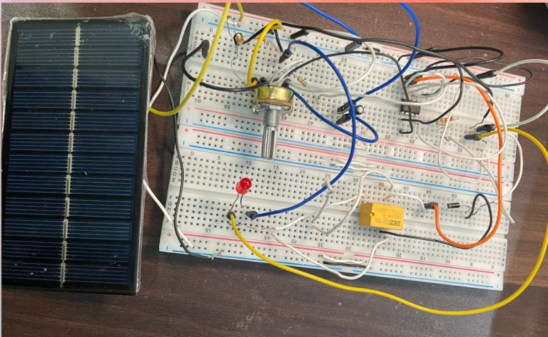
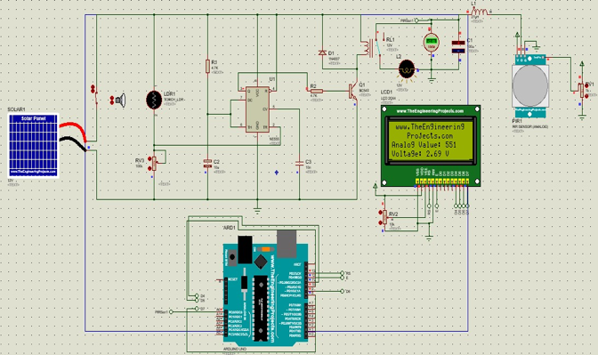
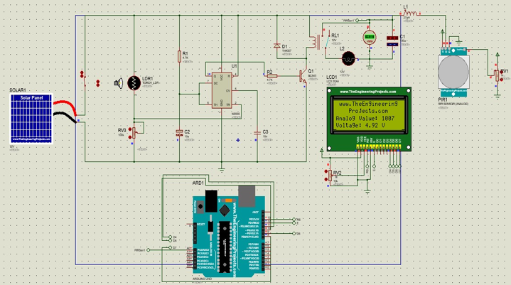
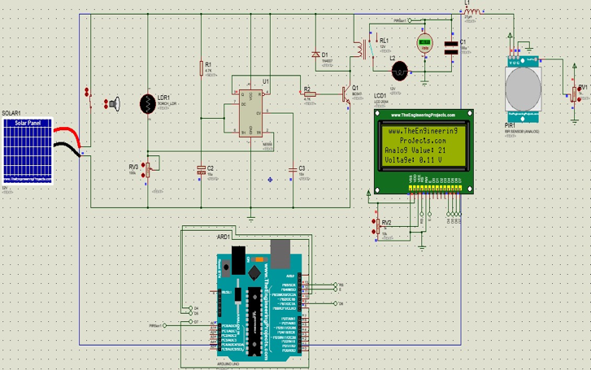

# Automatic Room Light & Fan Control System

An Arduino-based room automation prototype exploring energy-efficient control of lighting and a fan using **ambient light**, **motion detection**, and **solar power**. The project integrates an LDR, PIR sensor, NE555 timer, relay circuitry, and Arduino. The original project report describes a working hardware prototype and four simulation scenarios.



## Project overview

Traditional room lighting and fan setups often rely on manual switching. This project investigates automatic responses to room brightness and detected motion to reduce unnecessary operation. The report describes a solar panel supplying **12 V** to the circuit, LDR-based light detection, an NE555 timing stage, relay switching, and Arduino/PIR involvement.

**Project team:** Dania Farrukh Ghouri, Sundas Rathore, and Momina Tabassum.

## Main components

| Component | Role |
| --- | --- |
| Arduino | Microcontroller used with the motion sensor and control system |
| PIR motion sensor | Detects movement/presence |
| LDR | Senses ambient light |
| NE555 timer | Provides timing control |
| Relay | Switches the connected load |
| Solar panel | Provides renewable power to the prototype |
| BC547 transistor, resistors, capacitors, diode, potentiometer | Supporting signal, timing, and switching circuitry |
| Lamp and fan | Controlled outputs |

## System concept

```text
Solar panel / supply
        |
   Ambient light (LDR)
        |
 NE555 + relay switching
        |
 Motion sensing (PIR) / Arduino
        |
      Lamp & fan
```

This simplified conceptual sequence follows the project report's block diagram; it is **not** a detailed electrical wiring schematic or a substitute for circuit validation.

## Simulation scenarios

The report documents the following combinations of motion and ambient light. Screenshots are reproduced from that report.

| Scenario | Simulation |
| --- | --- |
| Motion detected, dark |  |
| Motion detected, bright |  |
| No motion, dark |  |
| No motion, bright |  |

The documentation identifies the scenarios, but it does not provide a machine-readable measurement dataset or a complete state-transition specification for each condition.

## Hardware prototype


The project report states that hardware and simulation were tested successfully. It does not include numerical power-consumption measurements or controlled energy-savings benchmarks, so no quantified savings are claimed here.

## Arduino sketch

[`arduino/pir_motion_sensor_test.ino`](arduino/pir_motion_sensor_test.ino) reproduces the **PIR motion detection test** in the report. It reads digital pin **2**, prints motion status to Serial Monitor at **115200 baud**, and checks once per second.

**Important:** The supplied report does **not** contain the complete Arduino code needed to control the LDR, timer, relay, lamp, or fan. The included sketch is a sensor test, not full automation firmware.

### Run the PIR test

1. Install Arduino IDE and select your Arduino board and port.
2. Connect a compatible PIR sensor output to Arduino digital pin **2**, with compatible power and common ground; confirm sensor pinout and voltage ratings first.
3. Open `arduino/pir_motion_sensor_test.ino` in Arduino IDE.
4. Upload the sketch and open Serial Monitor at **115200 baud**.
5. Move in front of the sensor and inspect the messages.

**Electrical safety:** Do not connect high-voltage mains loads directly to a breadboard or Arduino. Qualified supervision and proper isolation are required for any mains-powered lamp or fan.

## Repository structure

```text
automatic-room-light-fan-control-system/
├── README.md
├── arduino/
│   └── pir_motion_sensor_test.ino
├── images/
│   ├── hardware-prototype.png
│   ├── motion-detected-dark.png
│   ├── motion-detected-bright.png
│   ├── no-motion-dark.png
│   └── no-motion-bright.png
├── docs/
│   └── LCS-Project-Report.docx
└── GITHUB_UPLOAD_INSTRUCTIONS.md
```

## Future improvements

- Measure energy use under controlled conditions.
- Explore wireless monitoring and additional environmental sensors.

## Project documentation

Read the full original report: [`docs/LCS-Project-Report.docx`](docs/LCS-Project-Report.docx). All project photographs and simulation screenshots in this repository were extracted from that report.

## Attribution

Project work credited to **Dania Farrukh Ghouri, Sundas Rathore, and Momina Tabassum** as listed in the original report. No license is included because permissions for relicensing shared team work were not specified.
